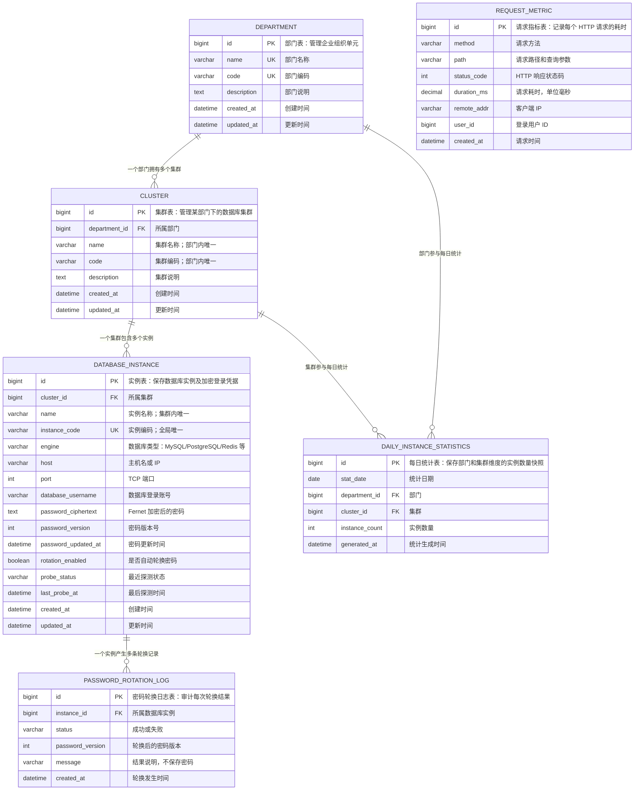

# 数据库实例管理系统（Django + Celery）

这是一个面向企业内部数据库资产的管理示例，覆盖部门、集群、实例、加密凭据、TCP 端口探测、密码定时轮换、每日实例统计以及请求耗时观测。

## 核心能力

| 能力 | 实现位置 | 行为 |
| --- | --- | --- |
| 部门、集群、实例模型 | `database_manager/models.py` | 外键保护、名称/编码唯一约束、查询索引 |
| CRUD API | `database_manager/views.py`、`serializers.py`、`urls.py` | DRF ViewSet，默认要求登录 |
| TCP 探测 | `POST /api/instances/{id}/probe-port/` | 建立一次短 TCP 连接并记录在线状态 |
| 凭据加密 | `database_manager/security.py` | Fernet 对称加密，API 永不返回明文或密文 |
| 12 小时密码轮换 | `database_manager/tasks.py`、`services.py` | 每实例独立 Celery 任务、行锁、审计记录 |
| 每日实例统计 | `database_manager/tasks.py`、`services.py` | 每日 00:00 按部门和集群幂等写入快照 |
| 请求耗时 | `database_manager/middleware.py` | 所有请求写入 `RequestMetric`，响应附带耗时头 |

## 架构数据流

```text
浏览器 / 运维脚本
        |
        v
DRF API (views + serializers + permissions)
        |
        v
领域服务 (services.py) --------> Django ORM --------> 业务数据库
        |                              |
        |                              +--> 加密凭据、统计、审计、请求指标
        |
        +--> TCP probe (socket)

Celery Beat
   |-- 每天 00:00 / 12:00 --> dispatch_password_rotation
   |                              |-- 每个实例 --> rotate_database_instance_password
   |                              |                 |--> 随机密码 + Fernet 加密
   |                              |                 +--> PasswordRotationLog
   |
   +-- 每天 00:00 ----------> collect_daily_instance_statistics
                                  |--> 按集群 Count
                                  +--> DailyInstanceStatistics upsert
```

时区固定为 `Asia/Shanghai`，所以 Celery 中“00:00”和“每 12 小时”均按北京时间执行。

## 数据库 ER 图



业务资产关系的主链是：

```text
部门 1:N 集群 1:N 数据库实例 1:N 密码轮换日志
```

每日统计表同时关联部门和集群，并对“统计日期 + 部门 + 集群”设置联合唯一约束，因此每天、每个集群只有一条统计快照。请求耗时表是独立的监控数据，不与业务资产建立外键关系。

实例的部门信息通过 `实例 → 集群 → 部门` 获得，没有直接保存 `department_id`。删除规则方面，部门、集群和实例采用 `PROTECT`：只要仍有下级数据，就不能删除；密码轮换日志随实例删除。

## 目录与文件职责

```text
E:\apps
├── manage.py                         Django 命令行入口
├── requirements.txt                  运行依赖及版本范围
├── compose.yaml                      本地 Redis 容器配置
├── .env.example                      环境变量模板，不包含真实密钥
├── README.md                         启动、接口与设计说明
├── config/
│   ├── __init__.py                   加载 Celery app
│   ├── settings.py                   Django、DRF、Celery、时区及定时计划
│   ├── urls.py                       管理后台、登录页和 API 总路由
│   ├── celery.py                     Celery 应用与任务自动发现
│   ├── wsgi.py                       WSGI 部署入口
│   └── asgi.py                       ASGI 部署入口
└── database_manager/
    ├── models.py                     部门、集群、实例、统计、轮换日志、请求指标
    ├── serializers.py                输入校验、密码只写、响应字段脱敏
    ├── views.py                      CRUD ViewSet、过滤和端口探测 Action
    ├── urls.py                       DRF Router 资源路由
    ├── services.py                   TCP 探测、密码轮换、每日统计等业务逻辑
    ├── security.py                   Fernet 加解密和随机密码生成
    ├── tasks.py                      Celery 异步任务与重试
    ├── middleware.py                 请求耗时测量与持久化
    ├── exceptions.py                 外键保护删除转换为 HTTP 409
    ├── admin.py                      后台维护、只读审计页面和轮换操作
    ├── apps.py                       Django 应用配置
    ├── migrations/0001_initial.py    初始数据库结构
    └── tests/                        模型、服务、API、中间件测试
```

## 本地启动

要求 Python 3.10+、Redis。以下命令以 PowerShell 为例：

```powershell
cd E:\apps
python -m venv .venv
.\.venv\Scripts\Activate.ps1
python -m pip install -r requirements.txt
Copy-Item .env.example .env
docker compose up -d redis
```

生成 Fernet 密钥并填入 `.env`：

```powershell
python -c "from cryptography.fernet import Fernet; print(Fernet.generate_key().decode())"
```

把输出粘贴到 `.env` 的 `CREDENTIAL_ENCRYPTION_KEY=` 后面，然后执行：

```powershell
python manage.py migrate
python manage.py createsuperuser
python manage.py runserver
```

开发环境若 `DJANGO_DEBUG=true` 且未配置 Fernet 密钥，程序会从 `SECRET_KEY` 派生临时密钥。关闭 Debug 后必须显式配置 `CREDENTIAL_ENCRYPTION_KEY`，否则加密操作会拒绝执行。

另开两个终端启动异步处理：

```powershell
# Windows 建议使用 solo 进程池
celery -A config worker --loglevel=info --pool=solo
```

```powershell
celery -A config beat --loglevel=info
```

Windows 当前终端如果不识别 `celery`，使用：

```powershell
python -m celery -A config worker --loglevel=info --pool=solo
python -m celery -A config beat --loglevel=info
```

## API 一览

所有业务接口默认要求登录。可先访问 `/api-auth/login/`，也可使用 HTTP Basic Auth。

| 路由 | 方法 | 说明 |
| --- | --- | --- |
| `/api/` | GET | API 根入口 |
| `/api/departments/` | GET、POST | 部门列表、创建 |
| `/api/departments/{id}/` | GET、PUT、PATCH、DELETE | 部门详情、更新、删除 |
| `/api/clusters/` | GET、POST | 集群列表、创建 |
| `/api/clusters/{id}/` | GET、PUT、PATCH、DELETE | 集群详情、更新、删除 |
| `/api/instances/` | GET、POST | 实例列表、创建 |
| `/api/instances/{id}/` | GET、PUT、PATCH、DELETE | 实例详情、更新、删除 |
| `/api/instances/{id}/probe-port/` | POST | TCP 端口探测 |
| `/api/daily-statistics/` | GET | 每日统计列表 |
| `/api/daily-statistics/{id}/` | GET | 每日统计详情 |
| `/api/password-rotation-logs/` | GET | 密码轮换日志列表 |
| `/api/password-rotation-logs/{id}/` | GET | 密码轮换日志详情 |
| `/api/request-metrics/` | GET | 请求耗时指标列表 |
| `/api/request-metrics/{id}/` | GET | 请求耗时指标详情 |

实例列表还支持 `cluster`、`department`、`engine`、`probe_status` 和 `search` 查询参数。

创建实例示例：

```powershell
$body = @{
    cluster = 1
    name = "order-mysql-01"
    instance_code = "ORDER-MYSQL-01"
    engine = "mysql"
    host = "127.0.0.1"
    port = 3306
    database_username = "order_app"
    password = "Initial-Password-123!"
} | ConvertTo-Json

Invoke-RestMethod -Method Post `
    -Uri "http://127.0.0.1:8000/api/instances/" `
    -Authentication Basic `
    -Credential (Get-Credential) `
    -ContentType "application/json" `
    -Body $body
```

探测端口示例：

```powershell
Invoke-RestMethod -Method Post `
    -Uri "http://127.0.0.1:8000/api/instances/1/probe-port/" `
    -Authentication Basic `
    -Credential (Get-Credential)
```

## 设计说明与运维注意

1. **密码安全**：密码通过 `Fernet` 加密存储；序列化器不返回密码，轮换时使用数据库行锁，审计表只保存版本、状态和错误类型。
2. **密码轮换范围**：当前实现轮换系统托管的实例登录凭据，并加密保存新值。若要求同时修改远端数据库服务自身账号密码，应在 `services.py` 中增加按 `engine` 分派的数据库管理连接适配器，在远端 `ALTER USER` 成功后再提交本地密文；不能只改本地记录。生产环境应把 Fernet 主密钥放入 KMS/Vault，并制定密钥轮换与恢复流程。
3. **权限**：默认仅要求登录。生产中应按部门建立对象级权限，不向所有登录用户开放实例凭据修改和 TCP 探测能力。
4. **探测限制**：TCP 探测只验证连接是否建立，不验证数据库认证或业务可用性；内网主机由登录用户修改后，需防止越权扫描。
5. **任务可靠性**：Beat 只负责投递计划；Worker 才真正执行任务。密码任务采用每实例独立任务和重试避免批量失败；统计任务使用唯一约束和 `update_or_create` 保证重复执行幂等。
6. **指标保留**：每个请求都会写一条 `RequestMetric`。生产环境应设置定期归档/清理，并接入 Prometheus、OpenTelemetry 等监控后端。
7. **数据删除**：部门、集群、实例使用 `PROTECT`，有下级对象时删除返回 HTTP 409，避免误删资产。

## 验证

```powershell
python manage.py check
python manage.py makemigrations --check --dry-run
python manage.py test --verbosity 2
```

当前测试共 12 项，覆盖模型约束、加密、轮换、统计、探测、CRUD、删除保护和请求耗时中间件。
